<div align="center">


# Oggy

**Control your Windows PC with your voice or your phone, and run a team of AI coding agents.**

Say what you need. Oggy opens your apps, sorts your files, turns your inbox into a to-do list, and hands real coding work to a team of agents. Anything risky waits for your yes.

[**Download for Windows**](https://github.com/AymaanPathan/oggy/releases/latest/download/Oggy-Setup.exe) · [Website](https://oggy-landing.vercel.app) · [Quick setup](#8-setup-download-the-app) · [Developer setup](#9-setup-clone-the-repo)

Built with [Switch](https://switchagents.ai) and [Wispr Flow](https://wisprflow.ai)

<a href="landing/assets/oggy-demo.mp4">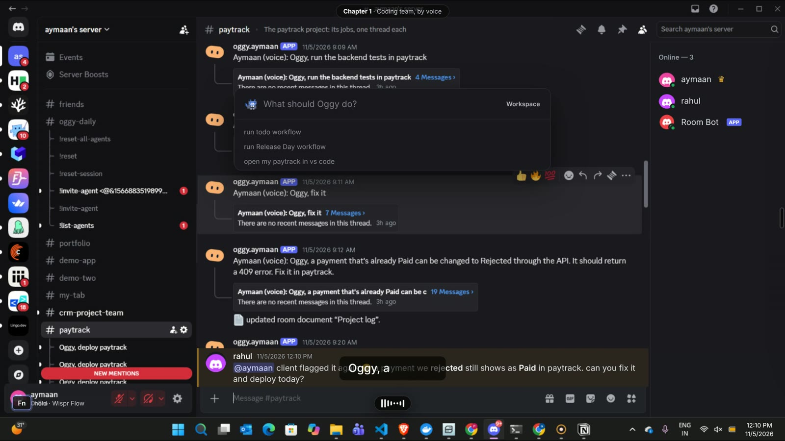</a>

*Click the image to watch the demo: a voice request, the plan, the agents at work, the team vote and the deploy.*

</div>

---

## Contents

1. [What is Oggy?](#1-what-is-oggy)
2. [Using Oggy](#2-using-oggy)
3. [You stay in charge](#3-you-stay-in-charge)
4. [A coding team that works for you](#4-a-coding-team-that-works-for-you)
5. [Workflows](#5-workflows)
6. [How Switch makes this possible](#6-how-switch-makes-this-possible)
7. [Architecture](#7-architecture)
8. [Setup: download the app](#8-setup-download-the-app)
9. [Setup: clone the repo](#9-setup-clone-the-repo)
10. [Configuration reference](#10-configuration-reference)
11. [Local API reference](#11-local-api-reference)
12. [Security model](#12-security-model)
13. [Troubleshooting](#13-troubleshooting)
14. [FAQ](#14-faq)

---

## 1. What is Oggy?

Oggy is a Windows desktop app that does two jobs.

- **It's your PC assistant.** It opens apps and folders, moves and zips files, takes screenshots, changes the volume, and reads your mail into a Notion to-do list.
- **It manages a team of coding agents.** Describe a bug or a feature once. Oggy plans the work, gives each step to the right agent (a scout, a backend dev, a tester, a reviewer), shows you what changed, and ships it once your team agrees.

You can talk to it in three ways. All three run the same pipeline and follow the same safety rules.

| Where you are | What you do | What it uses |
| --- | --- | --- |
| **At your PC, talking** | Press `Ctrl` + `Space`, hold your Wispr Flow key, speak, press `Enter` | Wispr Flow |
| **At your PC, typing** | Press `Ctrl` + `Space`, type, press `Enter` | Nothing extra |
| **Away from your PC** | Message `@oggy` in Discord from your phone | Switch |

### The idea in one picture

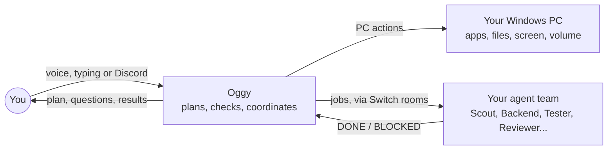

Oggy never writes your project's code itself. It **plans, checks and coordinates**. The agents do the work, and you make the decisions.

---

## 2. Using Oggy

### By voice or keyboard

1. **Press `Ctrl` + `Space`.** The Oggy box opens on top of whatever you're doing.
2. **Hold your Wispr Flow key and speak**, or just type.
3. **Press `Enter`.** Oggy works out what you meant, does it, and tells you the result.


### Things you can say

| Say | What happens |
| --- | --- |
| "Take a screenshot" | Saves a screenshot to your Pictures folder |
| "Open my Downloads" | Opens the folder |
| "Mute" / "Volume 30" | Changes the sound |
| "Open VS Code" / "Close Notepad" | Opens or closes the app |
| "Move these files to Documents" / "Zip this folder" | Moves, copies, renames or zips files |
| "Undo that" | Puts back the last file change |
| "Open paytrack in VS Code" | Opens the project in your editor |
| "Start the dev server in paytrack" | Starts it in a VS Code terminal you can see, and can stop it later |
| "Check my mail and make a to-do list" | The Assistant agent reads unread mail and writes tasks in Notion |
| "Fix the 500 on huge payment amounts in paytrack" | The coding team finds the bug, fixes it and tests it |
| "Create a project called flowboard with React, then open it in VS Code" | An agent builds it, then Oggy opens it |
| "Deploy paytrack" | Calls a team vote, then the Release agent ships it |

You can chain commands with "and", "then" or commas: *"close Chrome and Notepad, then mute"*.

If something's unclear, Oggy asks a short question ("Which one, the PDF or the DOCX?"). Just answer in the box.

Everything you ask for is logged in the **Daily** view, including what failed and why.

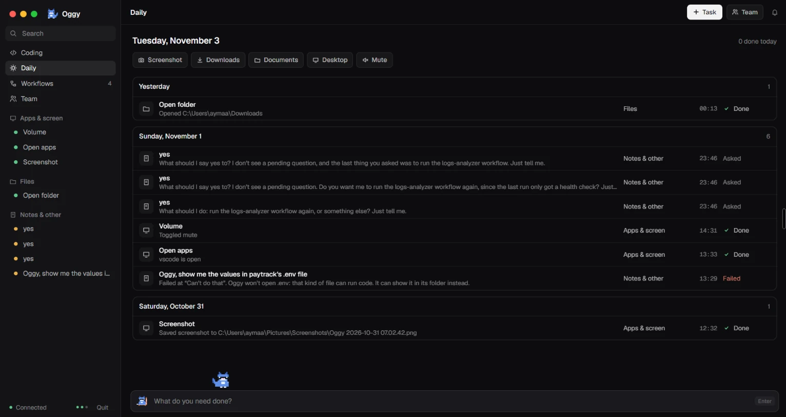

### From your phone

Your phone doesn't connect to your PC directly. It goes through Discord and Switch, so you don't open any ports and don't need to be on the same network.

> **Your PC must be on, with Switch Console and Oggy running.** Oggy does the work on your PC. Your phone is only the remote.

Send a message that starts with `@oggy` in a channel Oggy is in:

```text
@oggy open my Downloads
@oggy take a screenshot
@oggy run todo workflow
@oggy deploy paytrack
```

`oggy, take a screenshot` and `hey oggy, mute` work too. Oggy replies in the same place with its plan, any question, and the result. Reply `yes` or `no` to approve or stop a step.

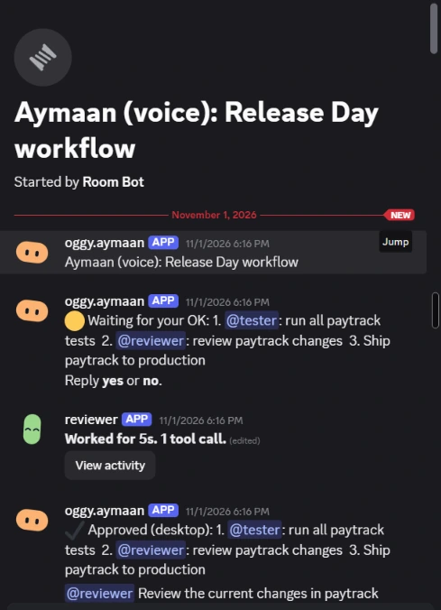

Install Wispr Flow on your phone too, and you can speak these messages instead of typing them.

### Your work stays organised in Discord

Commands you give at your PC show up in Discord too, so your phone always has the full story.

- **Each job gets its own thread:** the request, every hand-off, every approval and the result.
- **Each project gets its own room**, created the first time you need one.
- **Everyday tasks go to `#oggy-daily`.** Coding jobs go to the project's room, or `#team`.

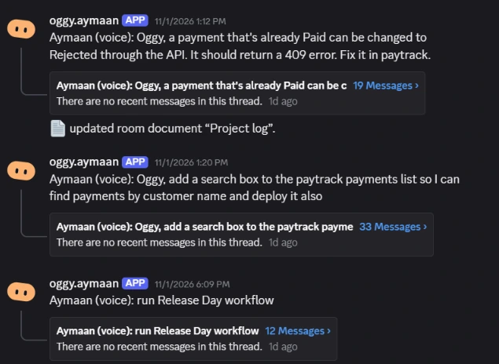

---

## 3. You stay in charge

**Every step passes a safety gate right before it runs:**

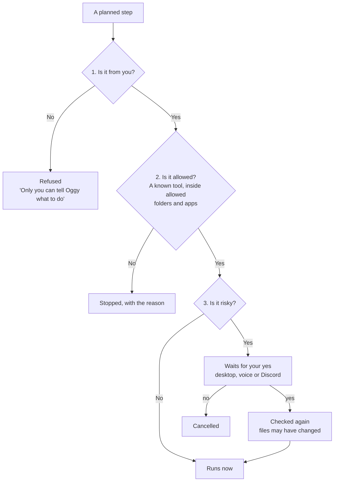

1. **Is it from you?** Desktop commands carry a secret owner token. Discord commands must come from the username you gave in setup, or your exact Switch account once you've typed `lock oggy to me`.
2. **Is it allowed?** Oggy can only use its own fixed set of tools (the *toolbox*), inside the folders and apps you allow. It only opens safe file types like documents, photos and videos. It won't open a script or a `.env` file, for example.
3. **Is it risky?** Deleting, moving or renaming files, pressing keys for you, installing packages and deploying always ask first.

**For agent jobs, you see the plan first.** Click **Allow**, say yes, or reply `yes` in Discord. One yes covers the whole plan.


**After the agents finish, you review.** Oggy explains in plain words what was wrong, why, what changed and how it was tested, with the diff. Say "looks good", "undo it", or ask for a change ("make the error message friendlier").

**Shipping needs the whole team.** Merging to main and deploying can't be undone, so Oggy calls a vote and only goes ahead if everyone replies `yes`. One `no` stops it.

<table>
<tr>
<td width="50%">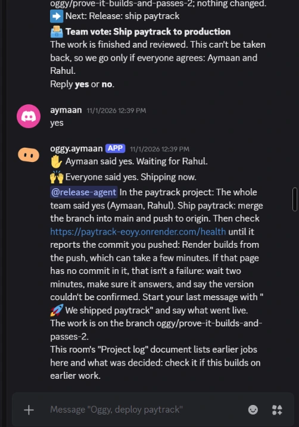<br /><sub>Oggy calls the vote</sub></td>
<td width="50%">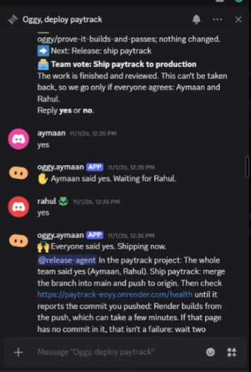<br /><sub>Everyone replies yes</sub></td>
</tr>
</table>

---

## 4. A coding team that works for you

You describe the problem once. Oggy splits it into steps and gives each one to the right agent.

| Agent | Its one job |
| --- | --- |
| **Claude** | General coding, setup, scripts and new projects (the default) |
| **Scout** | Finds the cause of a bug, with file names and lines. Never edits |
| **Frontend** | UI code only |
| **Backend** | APIs, servers and databases only |
| **Tester** | Proves a bug with a failing test, then confirms the fix. Only changes test files |
| **Reviewer** | Replies `LOOKS GOOD` or `CHANGES NEEDED`. Never edits |
| **Release** | Writes release notes, then merges and deploys after the team vote |
| **Assistant** | Reads Gmail and Calendar, writes in Notion, drafts emails. Never sends them |

Each agent is a Claude Code session you add in Switch Console. You don't need all eight: start with one and add more as you go.


### What a bug fix looks like

"Fix the 500 on huge payment amounts in paytrack" becomes a plan like this. Steps that don't depend on each other run at the same time.

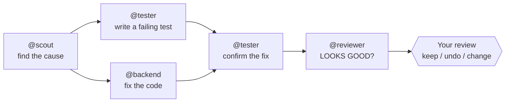

While they work, the **Team** view shows each agent live: what it's reading, editing or running. Every job appears on the **Coding** board, and anything waiting for you lands in **Needs you**.


### Shipping

"Deploy paytrack" (or the end of a fix) goes like this:

1. The **Release** agent writes release notes.
2. Oggy calls a **team vote** in Discord. Everyone must say `yes`.
3. The Release agent merges to `main` and pushes. Your host (for example Render) builds from the push.
4. **Oggy checks for itself.** It calls your health URL and looks for the commit it just pushed, so "it's live" is proven, not just claimed.

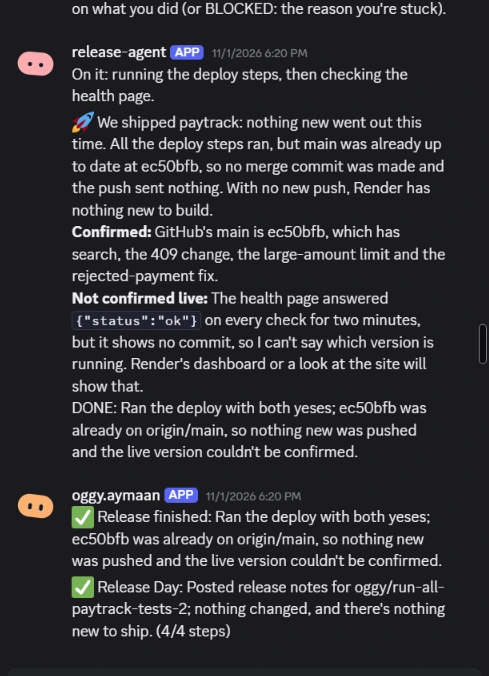

---

## 5. Workflows

Describe a routine once and Oggy saves it. After that you only need its name, or a schedule like "every weekday at 9am".

```text
make a new workflow named todo that checks my mail and creates a to-do list in Notion
run todo workflow
```

Claude designs the workflow from your words. Then Oggy **checks every part against what's real**: the agents you have, your teammates, your projects, what can deploy. Only then is it saved. A saved workflow runs exactly as it's drawn in the app. Nothing gets added at run time.

Steps can run side by side and can stop for someone's approval. **Release Day** tests and reviews at the same time, then deploys once you approve.


**todo** turns your unread mail into a Notion list and posts a short report.

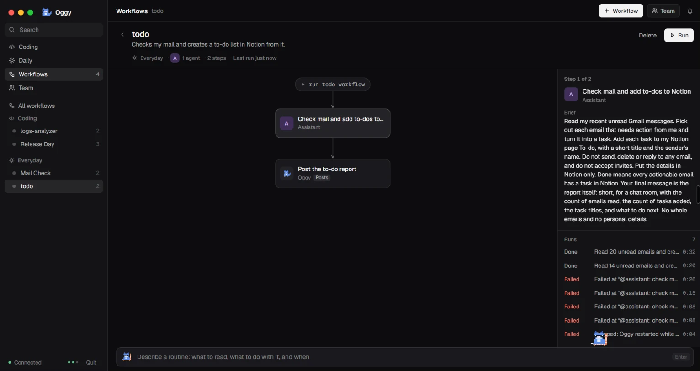

<table>
<tr>
<td width="62%">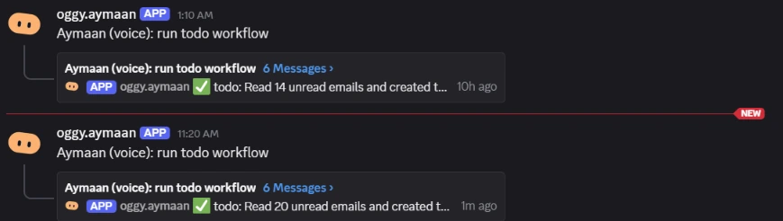<br /><sub>Run by voice, reported in Discord</sub></td>
<td width="38%">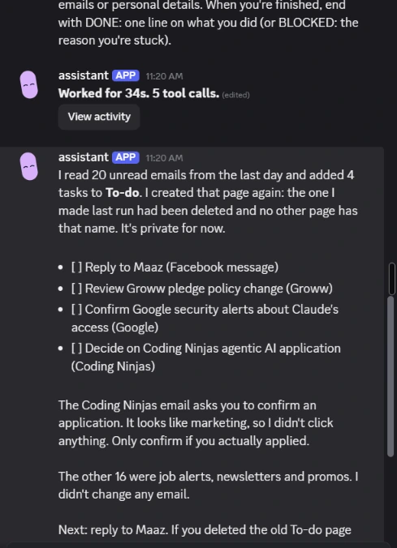<br /><sub>The report</sub></td>
</tr>
</table>

Scheduled workflows run while Oggy is open. If your PC was off at the scheduled time, the run happens when Oggy next opens, unless it's hours late. Every run is saved, so you can see what passed and what failed.

<table>
<tr>
<td width="50%"><br /><sub>Coding workflows</sub></td>
<td width="50%"><br /><sub>Everyday routines</sub></td>
</tr>
</table>

---

## 6. How Switch makes this possible


[Switch](https://switchagents.ai) puts people and AI agents together in shared **rooms**, and bridges those rooms to chat apps like Discord. It's the backbone of Oggy. Without it, Oggy would be a desktop app with no team, no phone control and no shared history.

**Oggy is itself a Switch agent.** It holds one live connection to your Switch server and appears in rooms as `@oggy`, next to the agents it coordinates.

### What each Switch feature does for Oggy

| Switch feature | How Oggy uses it | What you get |
| --- | --- | --- |
| **Agents** | Your coding team are Claude Code agents added in Switch Console. Oggy messages each one its step | A real team, not one overloaded AI |
| **Rooms** | `#team` for coding, `#oggy-daily` for everyday tasks, plus **one room per project** that Oggy creates on demand | Nothing gets mixed up |
| **Threads** | Every job is one thread: the request, every hand-off, questions, approvals and the result | Each job reads like a work log |
| **Discord bridge** | Every room is also a Discord channel | Control your PC from your phone, from anywhere |
| **Roles** | Each agent's job is a "seat" (role) in `#team`. Whoever holds the seat gets that kind of work | Swap who does testing without changing Oggy |
| **Room documents** | Each work room keeps a **Project log**: what every job changed and what you decided. Oggy also writes your saved workflows as a document | The next job starts from what the room already knows |
| **References** | A project room gets the project's GitHub repo attached | Agents see history, issues and PRs |
| **Packages** | Team rules you define once get attached to every new project room | Same rules everywhere |
| **People in rooms** | Your teammates sit in the same rooms | They can vote `yes` / `no` on releases |
| **Agent protocol** | One WebSocket that resumes where it left off after a drop | Oggy doesn't miss messages |

### How Oggy talks to an agent

Agents end their replies with simple marker lines. That's the whole contract.

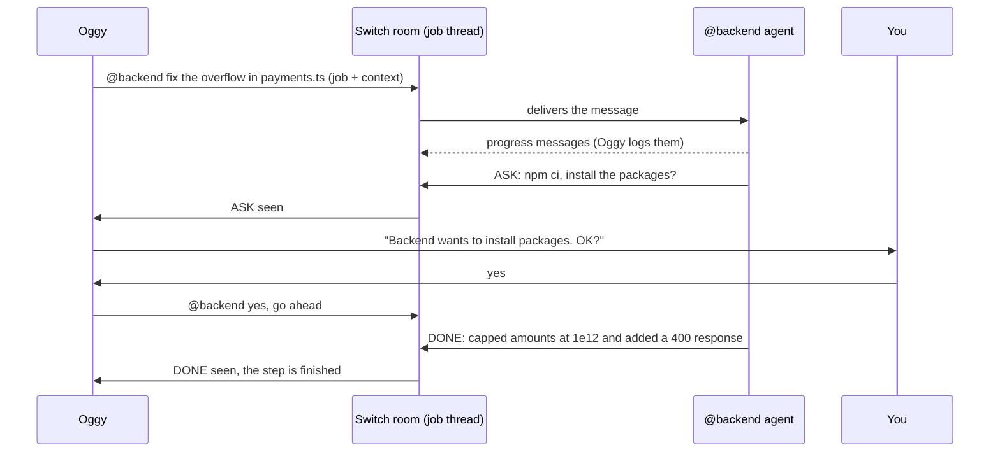

| Marker | Meaning |
| --- | --- |
| `DONE: ...` | Finished. The line becomes the step's result |
| `BLOCKED: ...` | Stuck. The run stops and tells you why |
| `LOOKS GOOD` | Reviewer approves |
| `CHANGES NEEDED` | Reviewer rejects, and the run stops |
| `ASK: ...` | The agent wants your OK before a heavy step. Oggy asks you and sends back your answer |

If an agent says nothing for 3 minutes, Oggy pings it once by name. After 30 minutes with no `DONE` or `BLOCKED`, the step times out.

### What Wispr Flow does


**Wispr Flow gives Oggy its ears.** It types your speech into whichever box your cursor is in, so Oggy needs no microphone code or speech model.

- It's a separate app. Oggy needs no key or connection to it.
- If a few words come out wrong, Oggy still works out what you meant. Project names are matched fuzzily against your real folders, so "dashboard crm" finds `dashboard-crm`.
- It's optional. Without it, you type in the same box.

---

## 7. Architecture

### The big picture

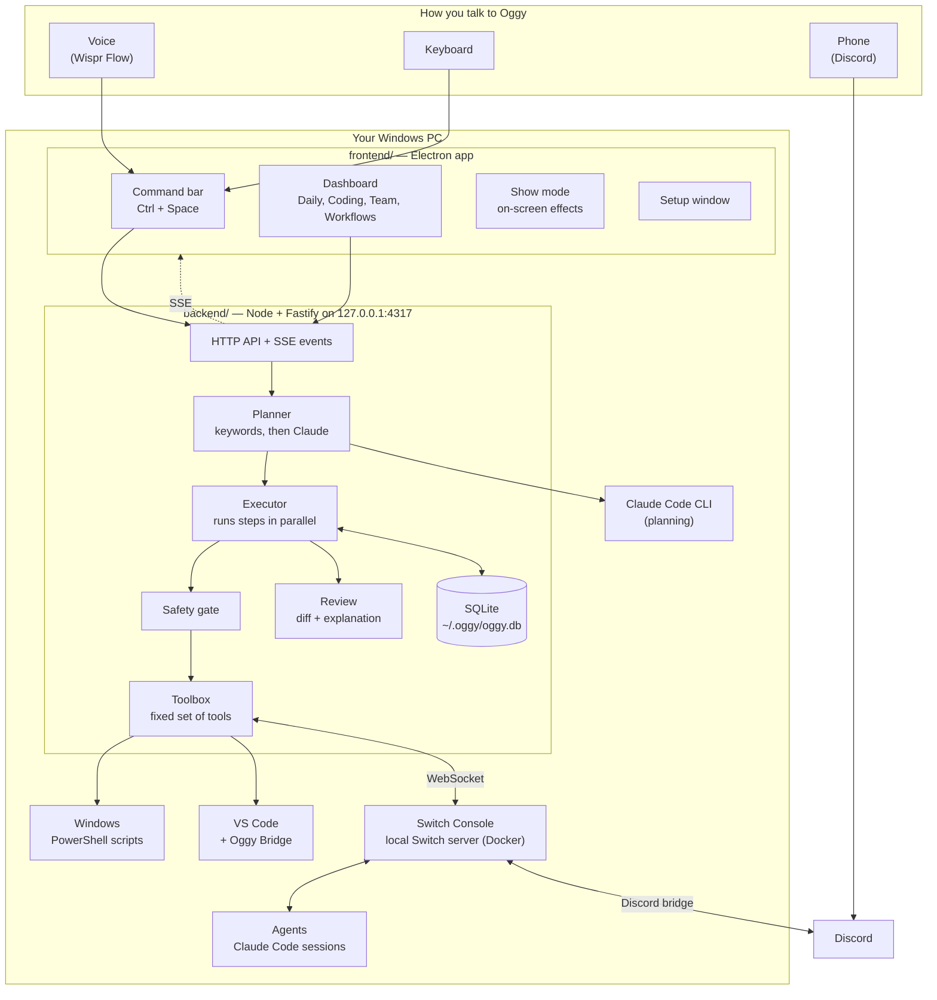

### The pieces

| Part | Where | What it does |
| --- | --- | --- |
| **Electron app** | [frontend/](frontend/) | The command bar, dashboard, Oggy the pet, show mode, tray icon and setup window. In the installed app it also starts and stops the backend |
| **Backend** | [backend/](backend/) | The brain. Plans commands, checks each step, runs them, talks to Switch, stores everything in SQLite. Listens only on `127.0.0.1` |
| **Oggy Bridge** | [vscode-bridge/](vscode-bridge/) | A small VS Code extension. Runs dev servers in a visible VS Code terminal, sends the output back to Oggy, and shows agent changes as a diff |
| **Website** | [landing/](landing/) | The landing page |
| **Config template** | [switch/config.example.json](switch/config.example.json) | What the setup window fills in |

### A request, start to finish

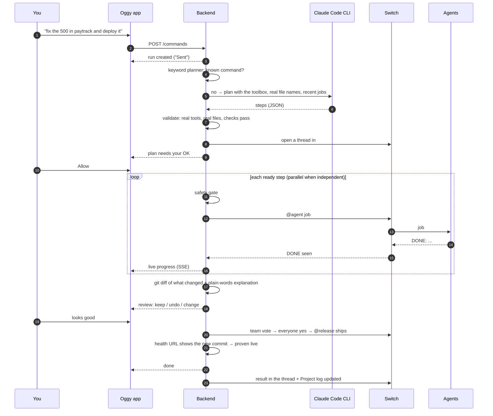

### Planning: two lanes

Oggy plans in two lanes, fast first.

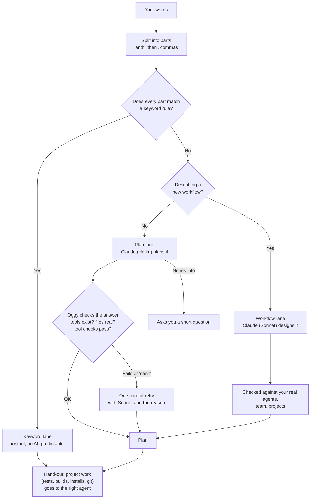

- **Keyword lane.** Common commands ("open my downloads", "mute", "start the dev server in X") are matched by rules. No AI call, so they're instant and always behave the same.
- **Plan lane.** Anything else goes to the Claude Code CLI (`claude -p`). Oggy gathers the facts itself (your real file names, project folders and scripts, what you did recently), and Claude only decides. **Oggy checks the answer** before anything runs. A rejected plan gets one more careful try with a stronger model and the reason.
- **Team habits are added for you.** If your request sounds like a bug ("broken", "fails", "fix"), a **Scout** step goes first to find the cause before anyone edits. Before any **deploy**, Oggy adds a **Tester** step (tests and build must pass), a **Reviewer** step if code changed, and **Release** notes, unless the plan already has them.
- **Hand-out.** Oggy never does project work itself. Running tests, builds, installs or `git status` on a project goes to the agent whose job it is (Tester, Scout). Which builder gets the code is decided by the request: UI words go to Frontend, API words to Backend, both to Backend first so the frontend gets its routes.

### Running: steps as a graph

A plan is a list of steps. Each step can say which steps it waits for (`after`). The executor starts **every step whose waits are done**, so independent work runs in parallel. If one step fails, no new steps start; the ones already working finish, then the run reports who got stuck.

Each step is a call to one **toolbox** tool:

| Group | Tools |
| --- | --- |
| Desktop | `app.open`, `app.close`, `folder.open`, `file.open`, `screen.shot`, `system.volume`, `keys.press` |
| Files | `file.copy`, `file.move`, `file.rename`, `file.zip`, `file.delete`, `undo` |
| Projects | `project.dev`, `project.stop`, `project.code`, `project.build`, `project.test`, `project.install`, `git.status` |
| Team | `agent.job`, `room.post`, `project.room`, `project.room.archive` |
| Shipping | `deploy`, `url.check` |
| Other | `calendar.event`, `workflow.create`, `workflow.save`, `memory.write`, `owner.lock`, `note` |

Every tool declares its own argument checks, whether it's risky, and a human preview line for approvals.

### Watching the agents

- **Live activity.** Every agent is a Claude Code session on your PC, and Claude Code writes each step to a transcript under `~/.claude/projects`. Oggy follows those transcripts, so the **Team** view shows who's working, waiting or idle, and their latest steps.
- **Code changes.** When a coding job starts, Oggy snapshots the project with git and follows every file the agents change. The review panel shows the real diff, not what the agents say they did. **Undo** uses git to put the project back.

### Where data lives

Everything is local, in `C:\Users\<you>\.oggy\`:

| File | What's in it |
| --- | --- |
| `config.json` | Your settings, including Oggy's Switch key. **Never commit this** |
| `token` | The owner token. Only holders can call the backend |
| `oggy.db` | SQLite: `runs` (every job and its steps), `approvals`, `workflows`, `memory` (threads, rooms, current project, last undo) |
| `backend.log` | Logs from the installed app |

### Tech stack

| Layer | Tech |
| --- | --- |
| Desktop app | Electron 33, React 18, Vite (electron-vite), TypeScript |
| Backend | Node 22, Fastify 5, better-sqlite3, `ws`, TypeScript (run with `tsx`) |
| Planning | Claude Code CLI (Haiku for quick plans, Sonnet for careful plans and workflows) |
| Agents and rooms | Switch (agent protocol over WebSocket, REST) |
| PC control | Fixed PowerShell scripts |
| Editor | VS Code extension (Oggy Bridge) |
| Installer | electron-builder (NSIS), with Node and the backend bundled inside |
| Tests | Node's built-in test runner |

---

## 8. Setup: download the app

**Use this if you just want to use Oggy.** It takes about 15 minutes, most of it on Discord and your agents.

### What you need

- Windows 10 or 11 (64-bit)
- [Docker Desktop](https://www.docker.com/products/docker-desktop/), which Switch Console uses to run its server on your PC
- [Claude Code](https://claude.com/claude-code), installed and signed in. Oggy uses it to plan, and your agents use it to work
- A Discord server where you can add a bot
- [Wispr Flow](https://wisprflow.ai), if you want voice
- [VS Code](https://code.visualstudio.com), if you want Oggy to open projects and run dev servers

### Step 1: Install Switch Console

1. Download [`switch-console-x64.exe`](https://github.com/sandbox-quantum/switch/releases/latest/download/switch-console-x64.exe) and run it.
2. Open Switch Console and choose **Run a server on this computer**.
3. Wait until it says **Running locally**.

More detail: [Install Switch Console](https://docs.switchagents.ai/switch-rooms/getting-started/install-switch-console.md) and [Add a server](https://docs.switchagents.ai/switch-rooms/getting-started/add-a-server.md).

### Step 2: Add your agents

1. In Switch Console, open **Your Agents** and click the card with the plus sign.
2. Fill in a **Name** (lowercase, no spaces) and a **Description**.
3. Leave **Run location** on **This computer**, set **Directory** to your code folder, and pick **Claude Code** as the **Agent provider**.
4. Click **Add agent**.

Start with one agent, such as `claude-code`, and add more whenever you like. Names like `scout`, `backend` or `tester` let Oggy guess each agent's job during setup.

More detail: [Onboard your agents](https://docs.switchagents.ai/switch-rooms/getting-started/onboard-your-agents.md).

### Step 3: Connect Discord

This step is what gives you phone control.

1. In the [Discord Developer Portal](https://discord.com/developers/applications), click **New Application**, open the **Bot** tab and copy the token.
2. On the same tab, turn on **Server Members Intent** and **Message Content Intent**.
3. Under **OAuth2 > URL Generator**, select the `bot` and `applications.commands` scopes, choose the permissions the Switch guide lists, and invite the bot to your server.
4. In Switch Console, open your server's **Home** page, then **Messaging apps > Connect > Discord**. Enter the bot token and your server ID, then click **Connect**.
5. Link your Discord account when it asks. Click **This is me**.

More detail, including the full permissions list: [Connect Discord](https://docs.switchagents.ai/switch-rooms/deploy/messaging-apps/discord.md).

### Step 4: Make Oggy's two rooms

Oggy finds its rooms by their exact names:

| Room | What goes there |
| --- | --- |
| `team` | Coding jobs |
| `oggy-daily` | Everyday tasks and routines |

Create a Discord channel with each name and post any message in it. Switch turns each channel into a room.

### Step 5: Install Oggy

1. Download [**Oggy-Setup.exe**](https://github.com/AymaanPathan/oggy/releases/latest/download/Oggy-Setup.exe) and run it.
2. Oggy's setup window opens. It has three parts:
   - **Connect.** Oggy finds Switch Console on your PC and registers itself as an agent. You don't copy any keys: it uses Switch Console's own admin sign-in to make a one-time registration key, registers, then deletes that key.
   - **Your team.** Tick the agents Oggy may use and pick each one's job.
   - **About you.** Your name, your Discord username (Oggy only takes orders from it) and your code folder.

### Step 6: Invite Oggy to the rooms

In Switch Console, invite Oggy (`oggy.<your-windows-name>`) to `team` and `oggy-daily`. Then quit Oggy from the tray and open it again so it picks up the rooms.

### Step 7: Try it

1. Check that Oggy says **Connected** at the bottom left of the dashboard.
2. Press `Ctrl` + `Space`, type `take a screenshot` and press `Enter`.
3. In Discord, send `@oggy open my Downloads` to `#oggy-daily`.
4. Type `lock oggy to me` in the Oggy box on your PC. This ties Oggy to your exact Discord account, so someone using your name can't give it orders.

That's the core setup done. The rest is optional.

### Optional extras

**Voice.** Install [Wispr Flow](https://wisprflow.ai). No other setup is needed.

**VS Code.** Install the Oggy Bridge extension from [vscode-bridge/oggy-bridge.vsix](vscode-bridge/oggy-bridge.vsix): in VS Code, open the Extensions panel, click **...**, choose **Install from VSIX...** and pick the file.

**Mail, calendar and Notion.** Add an agent called `assistant`, and connect Gmail, Google Calendar and Notion to the Claude account it runs on.

**Team votes and deploys.** Add your teammates and your project's health page to `C:\Users\<you>\.oggy\config.json`, then restart Oggy. Merge these into the file that's already there, don't replace it:

```json
{
  "team": [
    { "name": "Rahul", "discordUsername": "rahul-discord-name" }
  ],
  "deploy": {
    "paytrack": { "url": "https://your-app.example.com/health" }
  }
}
```

**Change your setup later.** Right-click Oggy's tray icon and choose **Set up Oggy again…**.

**Switch on another machine.** In the setup window, choose **Use a different Switch server**, then enter its address and a registration key from its admin page (**API Keys > Create Registration Key**).

---

## 9. Setup: clone the repo

**Use this if you want to run Oggy from source or change its code.** You still need Steps 1 to 4 and Step 6 from the setup above.

### Prerequisites

| Tool | Why |
| --- | --- |
| Windows 10 or 11 | Desktop actions use PowerShell and Windows APIs |
| [Node 22](https://nodejs.org) | Runs the backend and the build. `better-sqlite3` is native, so stay on 22 |
| [pnpm](https://pnpm.io/installation) | Package manager for both apps |
| [Git](https://git-scm.com) | Clone, plus Oggy uses git to track agent changes |
| [Claude Code](https://claude.com/claude-code) | The `claude` command must be on your `PATH` and signed in |
| Switch Console | Running locally (Step 1) |

### Repo layout

```text
oggy/
├── backend/                      The brain: local API on 127.0.0.1:4317
│   └── src/
│       ├── index.ts              HTTP routes, SSE stream, startup
│       ├── config.ts             Reads ~/.oggy/config.json and env vars
│       ├── planner.ts            Keyword planner, plan lane, workflow lane, hand-out
│       ├── executor.ts           Runs steps as a graph, approvals, results
│       ├── gate.ts               The three-question safety gate
│       ├── toolbox.ts            Every tool Oggy can use, with checks and risk
│       ├── desktop.ts            Windows actions (fixed PowerShell scripts)
│       ├── tools.ts              Project commands (package manager, git)
│       ├── review.ts             Explains changes, keep / undo / change
│       ├── codeWatch.ts          Git snapshots and live diffs of agent work
│       ├── agentLive.ts          Follows Claude Code transcripts for the Team view
│       ├── rooms.ts              "@oggy" from Discord, yes/no replies
│       ├── workflow.ts           Builds and checks workflows
│       ├── schedule.ts           Runs scheduled workflows
│       ├── team.ts               Teammates and votes
│       ├── ship.ts               Release jobs and the "is it really live?" check
│       ├── logs.ts               Fetches Render logs for the agents
│       ├── vscode.ts             Jobs for the VS Code bridge
│       ├── db.ts                 SQLite tables
│       ├── events.ts / trace.ts  Live events and job history
│       ├── shared/               Types shared with the frontend
│       ├── integrations/
│       │   ├── switch.ts         Switch WebSocket, rooms, threads, roles, logs
│       │   ├── claudeCode.ts     Planning with the Claude Code CLI
│       │   ├── codex.ts          Codex status
│       │   └── telegram.ts       Not used yet
│       └── *.test.ts             Tests
├── frontend/                     The Electron desktop app
│   ├── src/main/                 Main process: windows, tray, shortcut, setup, bundled backend
│   ├── src/preload/              Safe bridge between main and renderer
│   ├── src/renderer/src/         React UI: CommandBar, OggyApp (dashboard), Pet, Show, Setup, Workflows
│   ├── src/common/api.ts         IPC channel names
│   ├── scripts/pack.mjs          Bundles Node + backend + bridge for the installer
│   └── scripts/release.mjs       Publishes a GitHub release
├── vscode-bridge/                VS Code extension (and a prebuilt .vsix)
├── landing/                      The website
└── switch/config.example.json    Config template
```

### Run it

**1. Clone and install:**

```powershell
git clone https://github.com/AymaanPathan/oggy.git
cd oggy
cd backend; pnpm install; cd ..
cd frontend; pnpm install; cd ..
```

If `better-sqlite3` fails to install, check `node -v` shows 22, then run `pnpm rebuild better-sqlite3` in `backend/`.

**2. Run the setup window once.** This connects to Switch and writes `C:\Users\<you>\.oggy\config.json`.

```powershell
cd frontend
$env:OGGY_SETUP = "1"; pnpm dev
```

Finish the three setup steps, then keep this terminal open.

> Prefer to fill the config by hand? Copy [switch/config.example.json](switch/config.example.json) to `C:\Users\<you>\.oggy\config.json` and fill in `switch.apiUrl`, `switch.agentId`, `switch.agentApiKey`, `owner` and `paths.codeFolder`. See [Configuration reference](#10-configuration-reference).

**3. Start the backend in a second terminal:**

```powershell
cd backend
pnpm dev
```

You should see:

```text
[oggy] backend on http://127.0.0.1:4317
[oggy] data: C:\Users\<you>\.oggy  projects: C:\Users\<you>\code
```

The dashboard should now say **Connected** at the bottom left. Press `Ctrl` + `Space` to try it.

**4. Every time after that**, run `pnpm dev` in both `backend/` and `frontend/`. Skip `OGGY_SETUP` unless you want to run setup again.

> **Tip:** to test setup without touching your real config, point Oggy at a scratch folder first: `$env:OGGY_DATA_DIR = "C:\temp\oggy-test"`. Set it in both terminals.

### How the dev setup differs from the installed app

| | Installed app | From the repo |
| --- | --- | --- |
| Backend | Started by the Electron app from bundled Node | You run `pnpm dev` in `backend/` (auto-reloads) |
| Setup window | Opens automatically on first run | Only with `OGGY_SETUP=1` |
| Logs | `~/.oggy/backend.log` | Your terminal |
| Single instance | One Oggy at a time | The newest dev instance takes over |

### Useful commands

| Run in | Command | What it does |
| --- | --- | --- |
| `backend/` | `pnpm dev` | Runs the backend with auto-reload |
| `backend/` | `pnpm test` | Runs the tests |
| `backend/` | `pnpm typecheck` | Checks types |
| `backend/` | `pnpm build` / `pnpm start` | Compiles to `dist/` and runs it |
| `frontend/` | `pnpm dev` | Runs the Electron app with hot reload |
| `frontend/` | `pnpm typecheck` | Checks types |
| `frontend/` | `pnpm dist` | Builds `build/installer/Oggy-Setup.exe` |
| `frontend/` | `pnpm release` | Builds and publishes a GitHub release. Needs `gh auth login` and a new `version` in `frontend/package.json` |

### How the installer is built

`pnpm dist` runs three things:

1. **`scripts/pack.mjs`** builds `build/oggy/`: your machine's `node.exe`, the backend bundled into one `server.mjs`, `better-sqlite3` (native, so it's copied, not bundled), the VS Code bridge and the config template.
2. **`electron-vite build`** builds the app.
3. **`electron-builder`** wraps it all into a one-click NSIS installer. The `build/oggy` folder ships as `resources/oggy`, and [frontend/src/main/server.ts](frontend/src/main/server.ts) starts the backend from there.

### Adding a new tool

Want Oggy to do something new on your PC?

1. Add the tool to `TOOLBOX` in [backend/src/toolbox.ts](backend/src/toolbox.ts) with its `title`, `args`, `check` (reject bad arguments), `risky`, `preview` and `run`.
2. If it touches Windows, add a fixed PowerShell script in [backend/src/desktop.ts](backend/src/desktop.ts). Pass values as `OGGY_*` environment variables, never by pasting them into the script.
3. Optionally add a keyword rule in [backend/src/planner.ts](backend/src/planner.ts) so common phrasings skip the AI.
4. Add a test next to the module and run `pnpm test`.

The plan lane picks up new tools automatically, because Claude is given the toolbox list on every plan.

---

## 10. Configuration reference

### `~/.oggy/config.json`

The setup window writes this for you. Every field is optional. The full template is [switch/config.example.json](switch/config.example.json).

| Key | What it's for |
| --- | --- |
| `switch.apiUrl` | Your Switch server, e.g. `http://localhost:53754` |
| `switch.agentId`, `switch.agentApiKey` | Oggy's own Switch login. **Secret** |
| `switch.agentName` | Oggy's name in rooms, e.g. `oggy.aymaan` |
| `switch.packages` | Switch package ids to attach to every new project room (team rules) |
| `owner.name` | What Oggy calls you |
| `owner.discordUsername` | The only Discord user Oggy obeys |
| `owner.switchUserId` | Your exact Switch account. Set by `lock oggy to me` |
| `rooms.team`, `rooms.oggyDaily` | Room ids. Leave empty to find them by name |
| `team` | Your teammates: `{ "name", "discordUsername" }`. They vote on releases |
| `deploy.<project>` | `url` (health check), `branch` (default `main`), `service` or `hooks` (Render) |
| `agents.<alias>` | `name` (in Switch), `does` (one line Claude uses to pick it), `default` |
| `doneMarkers` | Change `DONE:`, `BLOCKED:`, `LOOKS GOOD`, `CHANGES NEEDED`, `ASK:` if you need to |
| `paths.codeFolder` | Where your projects live. "my portfolio" means `<codeFolder>/portfolio` |
| `paths.screenshots` | Where screenshots go (default `~/Pictures/Screenshots`) |
| `safety.needsApproval` | Extra tools that always ask, by name (`file.delete`) or last word (`delete`) |
| `safety.onlyObeyOwner` | Only run Discord commands from you (default `true`) |
| `safety.allowedFolders` | The only folders file tools may touch. Default: code folder, Desktop, Documents, Downloads, Pictures, Videos, Music |
| `safety.allowedApps` | Extra apps Oggy may open or close: `"figma": "figma"` or `{ "open": "...", "process": "..." }` |

### Environment variables

These override the config file. They're read from your shell (no `.env` file is loaded), so set them in PowerShell with `$env:NAME = "value"` before `pnpm dev`. [backend/.env.example](backend/.env.example) lists the backend ones.

| Variable | Default | What it does |
| --- | --- | --- |
| `OGGY_PORT` | `4317` | Backend port |
| `OGGY_DATA_DIR` | `~/.oggy` | Where config, token, database and logs live |
| `OGGY_PROJECTS_DIR` | `paths.codeFolder`, else `~/Projects` | Your code folder |
| `OGGY_TOKEN` | Generated in `~/.oggy/token` | The owner token |
| `OGGY_SHORTCUT` | `Control+Space` | The command bar shortcut |
| `OGGY_SETUP` | | `1` opens the setup window |
| `OGGY_OPEN_DASHBOARD` | | `1` opens the dashboard on start |
| `OGGY_BACKEND_URL` | `http://127.0.0.1:4317` | Where the app finds the backend |
| `SWITCH_API_URL`, `SWITCH_AGENT_ID`, `SWITCH_API_KEY`, `SWITCH_ROOM_ID` | | Override the Switch login and `#team` room |
| `RENDER_API_KEY` | | Lets Oggy fetch a live project's logs for the agents |
| `CLAUDE_BIN` | `claude` | Path to the Claude Code CLI |
| `CODEX_BIN` | `codex` | Path to the Codex CLI |

---

## 11. Local API reference

The backend listens on `http://127.0.0.1:4317` only. Every route except `/health` needs the owner token from `~/.oggy/token`:

```powershell
$token = Get-Content "$HOME\.oggy\token"
Invoke-RestMethod http://127.0.0.1:4317/commands -Method Post `
  -Headers @{ Authorization = "Bearer $token" } `
  -ContentType 'application/json' -Body '{"text":"take a screenshot"}'
```

| Method | Route | What it does |
| --- | --- | --- |
| `GET` | `/health` | Is the backend up (no token needed) |
| `POST` | `/commands` | Run a command: `{ "text": "...", "source": "desktop" }` |
| `GET` | `/runs` | All jobs |
| `GET` | `/runs/:id` | One job and its steps |
| `GET` | `/runs/:id/detail` | Its changes, review and full trace |
| `GET` / `POST` | `/runs/:id/review` | Read the review, or answer it: `{ "text": "looks good" }` |
| `POST` | `/runs/:id/changes/open` | Open a changed file in VS Code |
| `GET` | `/approvals?pending=1` | What's waiting for a yes |
| `POST` | `/approvals/:id` | Answer it: `{ "approve": true }` |
| `GET` | `/team` | Each agent, live |
| `GET` | `/toolbox` | Every tool Oggy can use |
| `GET` / `DELETE` | `/workflows`, `/workflows/:id` | Saved workflows |
| `GET` | `/memory` | Oggy's memory |
| `GET` | `/integrations` | Switch, Codex and Telegram status |
| `GET` | `/events` | Server-sent events: run updates, approvals, logs |
| `GET` / `POST` | `/vscode/jobs`, `/vscode/report` | Used by Oggy Bridge |

---

## 12. Security model

Oggy can touch your files and your code, so it's built to be careful.

- **Local only.** The backend binds to `127.0.0.1`. Nothing on your network can reach it.
- **Owner token.** Every API call needs the token in `~/.oggy/token` (generated on first start, compared in constant time).
- **Owner-only from Discord.** Room commands must come from your username, or your exact Switch account after `lock oggy to me`. Everyone else gets a polite no, and the safety gate checks again before every step.
- **No arbitrary commands.** Oggy only runs tools from its toolbox. Desktop actions are fixed PowerShell scripts that read values from environment variables, so a file name can't inject code. Project commands are a fixed binary plus a fixed argument shape. Oggy Bridge only runs `<package manager> run <script>`, both checked.
- **Allowed folders, apps and file types.** File tools can't leave your allowed folders, and Oggy only opens file types that can't run code, so no scripts and no `.env` files.
- **Risky means ask.** Deleting, moving, renaming, key presses, installs and deploys wait for your yes, and are checked again after you say yes.
- **Irreversible means vote.** Merging and deploying need every teammate's yes.
- **Proof, not claims.** Code changes are read from git, and deploys are checked against the live site.
- **Secrets stay put.** During setup, keys and passwords stay in Electron's main process; the setup window only sees names and addresses. Render logs are saved to a file, not posted in rooms, because they can hold customer data.

> **Never commit `config.json` or your token.** It holds Oggy's Switch key. If you ever do, rotate the key in Switch Console (re-run setup from the tray) and remove the file from git history.

---

## 13. Troubleshooting

| What you see | What to do |
| --- | --- |
| "Switch Console isn't installed on this PC" | Do [Step 1](#step-1-install-switch-console) |
| "Switch Console's server isn't running" | Open Switch Console (and Docker Desktop), wait for **Running locally**, then try again |
| No room named "team" | Do [Step 4](#step-4-make-oggys-two-rooms) and [Step 6](#step-6-invite-oggy-to-the-rooms) |
| The dashboard says **Disconnected** | The backend isn't running. From the repo, run `pnpm dev` in `backend/`. Installed, check `~/.oggy/backend.log` |
| `401 unauthorized` from the API | Send `Authorization: Bearer <contents of ~/.oggy/token>` |
| Oggy ignores your Discord messages | Check the username in setup matches yours exactly and Oggy is in that room. Your PC must be on with Oggy running |
| "Only X can tell Oggy what to do" | The message didn't come from your account. If you changed Discord accounts, re-run setup |
| An agent never answers | In Switch Console, check the agent is running and Claude Code is signed in. Oggy pings after 3 minutes and gives up after 30 |
| "Can't do that yet" for a normal request | Check `claude` works in a terminal (`claude -p "hi"`). Planning needs the Claude Code CLI |
| `Ctrl` + `Space` does nothing | Another app has it. Set `OGGY_SHORTCUT`, e.g. `Control+Shift+Space` |
| A dev server won't start in VS Code | Install Oggy Bridge (see [Optional extras](#optional-extras)) and open the project's folder in VS Code |
| The todo workflow can't reach Notion or Gmail | Connect them to the Claude account your `assistant` agent runs on |
| Deploy says "answering" instead of "proved" | Your health URL is up but doesn't show the commit. Include the git commit hash in its response |
| `better-sqlite3` errors after switching Node | Run `pnpm rebuild better-sqlite3` in `backend/` |
| `config.json is not valid JSON, ignoring it` | Fix the JSON. If `lock oggy to me` changed it, the previous version is in `config.json.before-lock` |

---

## 14. FAQ

**Does Oggy work on macOS or Linux?**
Not yet. Desktop actions use PowerShell and Windows APIs.

**Does my code leave my PC?**
Oggy itself runs locally. Planning uses the Claude Code CLI, which sends your request and the relevant file names to Claude. Your agents are Claude Code sessions, so they work the same way they would if you used Claude Code yourself. Room messages go through your Switch server and Discord.

**Do I need all eight agents?**
No. One general agent is enough to start. Add the others as you need them; during setup you pick which of your agents does which job.

**Do I need Discord?**
For phone control and team votes, yes. For voice and keyboard on your PC, Oggy still needs Switch for agent jobs, but everyday PC actions work without Discord.

**What happens if I close Oggy while a job is running?**
Jobs can't carry on without the backend, because what they were waiting for lived in its memory. Next time Oggy starts, it marks them as interrupted instead of leaving them "running" forever.

**Can I use a Switch server on another machine?**
Yes. In setup, choose **Use a different Switch server** and use a registration key from that server's admin page.

---

<div align="center">

### Built for the Flip the Switch Hackathon

Oggy was built for the [**Flip the Switch Hackathon**](https://www.wemakedevs.org/hackathons/switch), hosted by WeMakeDevs and DevTools Academy with Switch.

### ⭐ Like Oggy? [Star the repo](https://github.com/AymaanPathan/oggy)

It helps other people find it.

</div>
