<div align="center">

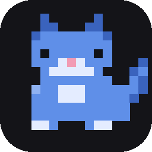

# Control your laptop with your voice and your phone

**Oggy turns one sentence into real work on your PC: everyday tasks done instantly, coding tasks handed to a team of 7 AI agents that talk to you and your team in Discord.**

*▶ Click to watch the demo: a voice request, the plan, the agents at work, the team vote and the deploy.*

[**⬇ Download for Windows**](https://github.com/AymaanPathan/oggy/releases/latest/download/Oggy-Setup.exe) · [🌐 Website](https://oggy-landing.vercel.app) · [⚡ Quick start](#quick-start) · [📖 Full setup](#full-setup-download-the-app)

Built with [Switch](https://switchagents.ai) and [Wispr Flow](https://wisprflow.ai)

</div>

---

## One sentence, two kinds of work

Press `Ctrl` + `Space` and speak (with Wispr Flow) or type. Or send `@oggy ...` from Discord on your phone. Oggy figures out which kind of job it is:

| | 🖥️ Everyday laptop tasks | 👩‍💻 Coding tasks |
| --- | --- | --- |
| **Who does it** | Oggy itself, on your PC | A team of 7 specialist agents |
| **How fast** | Usually under a second | Minutes, steps in parallel |
| **Example** | *"Move my invoices into a folder called Tax and zip it"* | *"Fix the 500 on huge payment amounts in paytrack and deploy it"* |
| **Where you see it** | A toast on your desktop | A live Discord thread with the whole team |

---

## 1. Everyday tasks on your laptop

No set phrases, no scripts. Say what you want and Oggy does it on your Windows PC, by voice, keyboard or phone.

| Say | What happens |
| --- | --- |
| "Take a screenshot" | Captures every screen and saves it |
| "Move my resume and offer letter into a folder called Jobs" | Finds the real files and moves them |
| "Zip the Jobs folder" / "Rename report.docx to final.docx" | Done, and you can undo it |
| "Delete the old screenshots" | Sent to the Recycle Bin, after you say yes |
| "Undo that" | Puts back the last file change |
| "Open my Downloads" / "Play the demo video" / "Open the PDF from yesterday" | Opens the folder or file in its usual app |
| "Open Spotify" / "Close Chrome and Notepad, then mute" | Several commands in one sentence |
| "Turn the volume down" / "Mute" | Changes system volume |
| "Save this file" / "Press Alt+F4" | Presses keys in the window you're using |
| "Start the dev server in paytrack" / "Open paytrack in VS Code" | Runs it in a VS Code terminal you can see |
| "Add a meeting with Sara tomorrow at 3" | Creates a calendar event |
| "Check my mail and make a to-do list" | Reads unread mail and writes tasks in Notion |
| "Remember that my staging URL is ..." | Oggy keeps the fact for later jobs |

If something's unclear, Oggy asks a short question (*"Which one, the PDF or the DOCX?"*). Anything risky (deleting, moving, pressing keys, installing) waits for your yes.

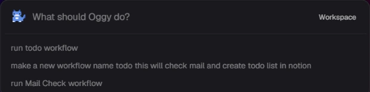

---

## 2. Coding tasks, handed to a team of agents

Oggy never writes your code itself. It acts as the team lead: it plans the job, gives each step to the agent whose job it is, runs independent steps in parallel and checks the result. **7 specialist agents are built in, each running in [Switch](https://switchagents.ai):**

| Agent | Its one job | What it never does |
| --- | --- | --- |
| 🔍 **Scout** | Finds the root cause of a bug, with file names and line numbers | Edit code |
| 🎨 **Frontend** | Fixes and builds UI code | Touch APIs, servers or databases |
| ⚙️ **Backend** | Fixes and builds APIs, servers and databases | Touch UI code |
| 🧪 **Tester** | Proves a bug with a failing test, then confirms the fix | Change anything except test files |
| 👀 **Reviewer** | Reads the diff and replies `LOOKS GOOD` or `CHANGES NEEDED` | Edit code |
| 🚀 **Release** | Writes release notes, then merges and deploys after the team vote | Deploy without every teammate's yes |
| 📬 **Assistant** | Reads Gmail and Calendar, writes in Notion, drafts emails | Send an email |


**A typical bug fix:**

1. **Scout** finds the root cause.
2. **Backend** (or **Frontend**) fixes it while **Tester** writes a failing test that proves the bug.
3. **Tester** confirms the fix passes and **Reviewer** checks the diff.
4. You see what changed, in plain words and as a real diff. Keep it, undo it, or ask for a change.
5. Your team votes, **Release** ships it, and Oggy checks the live site for the new commit.

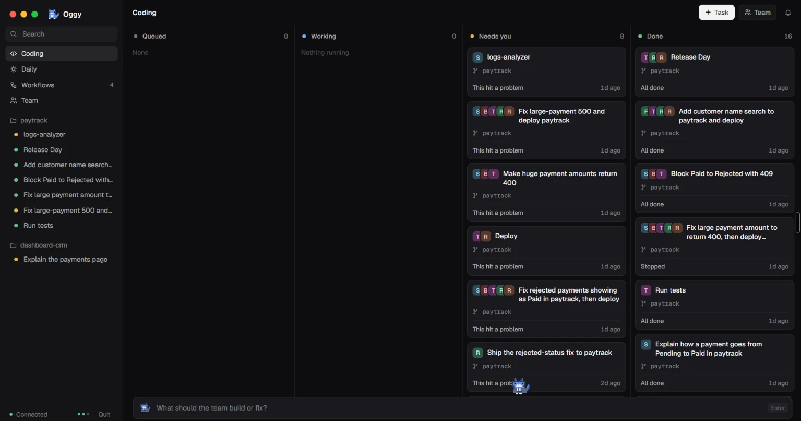

---

## 3. A Discord room where your whole agent team lives

Oggy and all 7 agents sit together in the `#team` room, which Switch bridges to Discord. So the room on your desktop is the same room on your phone:

- **Talk to any agent directly.** `@scout why does checkout fail on Safari?`
- **Start a job from anywhere.** `@oggy fix the login bug in paytrack and deploy it`
- **Approve steps.** Reply `yes` or `no` in the thread.
- **Vote on deploys.** Every teammate votes from their own phone. One `no` stops it.
- **Control your PC too.** `@oggy take a screenshot` in `#oggy-daily`.

Every job is one thread: the plan, each hand-off, every question and the result. No open ports, no VPN, no separate mobile app.

---

## 4. Every new project gets its own room

Say *"create a new project called habit-tracker, a React app with an Express API"* and Oggy:

1. **Creates a new Switch room (and Discord channel) for the project**, with you and the agents in it.
2. Attaches the project's facts as room instructions, plus its GitHub repo and your team rules.
3. Has the agents build it **inside that room**: Frontend and Backend in parallel, then Tester proves it installs, builds and passes.
4. Sends every later job for that project to the same room.

So each project has a dedicated channel where your human teammates and the 7 agents work as one engineering team, with a **Project log** that keeps what every job changed and what you decided. Done with it? *"Archive the habit-tracker room"* puts it away.

---

## Why Oggy?

- **Two jobs, one box.** Laptop chores and real engineering work from the same sentence.
- **An agent team, not a chatbot.** Each agent has one job, so its work is focused, checkable and can run in parallel.
- **Your phone is the remote.** Everything runs through Discord, from anywhere.
- **Safe by default.** Deletes, installs, key presses and deploys wait for a yes. Every change can be undone.
- **Ships, then checks.** Tests and review before every deploy, a team vote, and Oggy confirms the new commit is live.
- **Workflows you describe once.** Save a routine like *Release Day* and run it by name or on a schedule. [More on workflows](#workflows).

---

## See it in action

### From one sentence to production

<p align="center">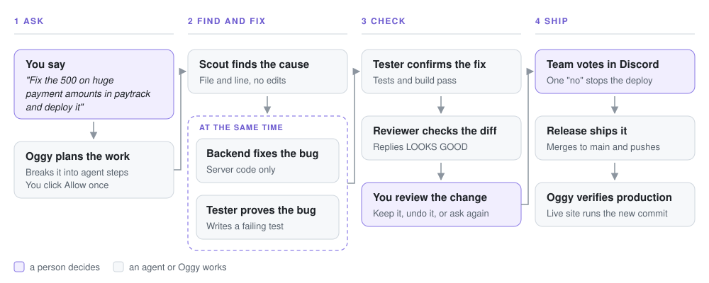</p>

Every step happens in one Discord thread, so your team can follow the whole story live.

---

## Under the hood

Oggy isn't one LLM call wrapped in a desktop UI. It has:

- **Instant, predictable commands.** Common PC actions are matched by rules, with no AI call.
- **AI planning for everything else.** Claude plans new requests, and Oggy checks every plan against real tools and real files before anything runs.
- **Graph-based execution.** Steps declare what they wait for, so independent work runs in parallel.
- **Specialised agents.** Each agent has one job and stays inside it.
- **Human approval gates.** Every step passes a safety check right before it runs.
- **Agent coordination through Switch.** Rooms, threads and a simple `DONE:` / `BLOCKED:` contract.
- **Git-based change tracking.** The review shows the real diff, and undo uses git.
- **Deployment verification.** "Live" means the site is running the new commit.
- **Local-first.** The backend, data and secrets stay on your PC.

The details are in [Architecture](#architecture).

---

## Quick start

1. **Start Switch.** Install [Switch Console](https://github.com/sandbox-quantum/switch/releases/latest/download/switch-console-x64.exe) and choose **Run a server on this computer**.
2. **Add an agent.** In Switch Console → **Your Agents**, add one Claude Code agent.
3. **Connect Discord** (optional, for phone control) and create two channels: `team` and `oggy-daily`.
4. **Install Oggy.** Run [Oggy-Setup.exe](https://github.com/AymaanPathan/oggy/releases/latest/download/Oggy-Setup.exe) and follow the setup window.
5. **Try it.** Press `Ctrl` + `Space` and type `take a screenshot`.

You'll need Windows 10 or 11 and [Claude Code](https://claude.com/claude-code) signed in. For every detail, see [Full setup](#full-setup-download-the-app). To run from source, see [Setup from source](#setup-from-source).

---

## Contents

- [How it works](#how-it-works) · [Safety](#safety) · [The agent team](#the-agent-team) · [Workflows](#workflows) · [How Switch makes this possible](#how-switch-makes-this-possible) · [Architecture](#architecture)
- [Full setup](#full-setup-download-the-app) · [Setup from source](#setup-from-source) · [Configuration](#configuration) · [Local API](#local-api)
- [Security model](#security-model) · [Troubleshooting](#troubleshooting) · [FAQ](#faq) · [Status](#status) · [Limitations](#limitations) · [Contributing](#contributing) · [License](#license)

---

## How it works

<p align="center">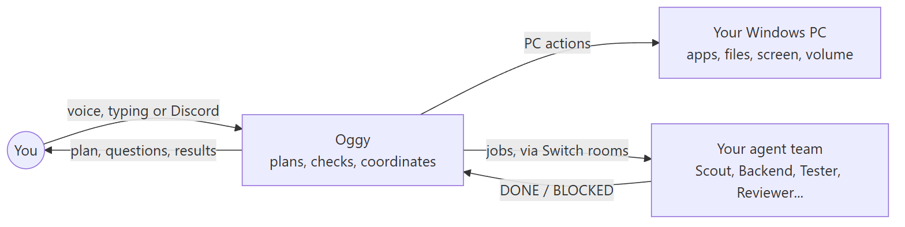</p>

1. **You ask**, by voice, keyboard or Discord.
2. **Oggy plans.** Known commands match instantly; anything else is planned by Claude and checked by Oggy.
3. **Every step is checked** right before it runs. Risky ones wait for your yes.
4. **The work runs.** PC actions run on your machine. Coding steps go to your agents through Switch, in parallel where possible.
5. **You see the result** on your desktop and in Discord, with a plain-words explanation of any code changes.

Oggy never writes your project's code itself. It **plans, checks and coordinates**. The agents do the work, and you make the decisions.

---

## Safety

**Every step passes three checks right before it runs:**

<p align="center"></p>

1. **Is it from you?** Desktop commands carry a secret owner token. Discord commands must come from your username, or your exact account once you've typed `lock oggy to me`.
2. **Is it allowed?** Oggy only uses its own fixed set of tools, inside the folders and apps you allow, and only opens file types that can't run code.
3. **Is it risky?** Deleting, moving or renaming files, pressing keys, installing packages and deploying always ask first.

On top of that:

- **You approve the plan** before agents start. One yes covers the whole plan.
- **You review the result.** Keep it, undo it, or ask for a change ("make the error message friendlier").
- **Shipping needs the whole team.** One `no` stops a deploy.

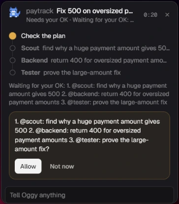

---

## The agent team

Oggy is the team lead. It never writes your project's code itself. Each agent below has exactly one job and stays inside it, the same way a real engineering team splits up work.

| Agent | Its one job | What it never does |
| --- | --- | --- |
| **Claude agent** | General coding, setup, scripts and new projects (the default) | Anything outside the step it was given |
| **Scout agent** | Finds the root cause of a bug, with file names and line numbers | Edit code |
| **Frontend agent** | Fixes and builds UI code | Touch APIs, servers or databases |
| **Backend agent** | Fixes and builds APIs, servers and databases | Touch UI code |
| **Tester agent** | Proves a bug with a failing test, then confirms the fix | Change anything except test files |
| **Reviewer agent** | Reads the diff and replies `LOOKS GOOD` or `CHANGES NEEDED` | Edit code |
| **Release agent** | Writes release notes, then merges and deploys after the team vote | Deploy without every teammate's yes |
| **Assistant agent** | Reads Gmail and Calendar, writes in Notion, drafts emails | Send an email |

**Why one job per agent?** A narrow job keeps each agent focused, makes its output easy to check, and lets work run in parallel. The Scout agent and Reviewer agent can't introduce bugs because they can't edit. The Tester agent can't "fix" a test by changing the app. A deploy can't happen without the Release agent, and the Release agent waits for the team.

Each agent is a Claude Code session you add in Switch Console. Start with one (it covers every job) and add more as you go.

**Good habits are added for you.** A request that sounds like a bug gets a Scout agent step first. Every deploy gets a Tester agent step, a Reviewer agent step (if code changed) and release notes. Independent steps run at the same time:

<p align="center">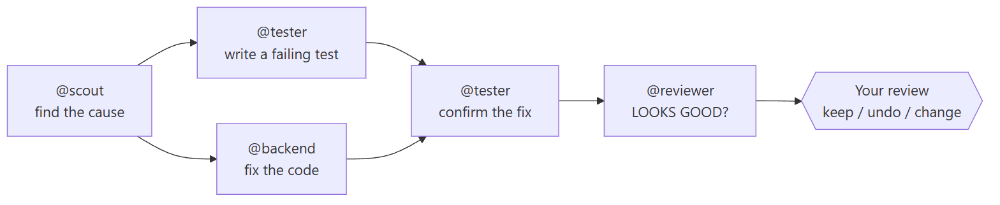</p>

The **Team** view shows each agent live: what it's reading, editing or running.

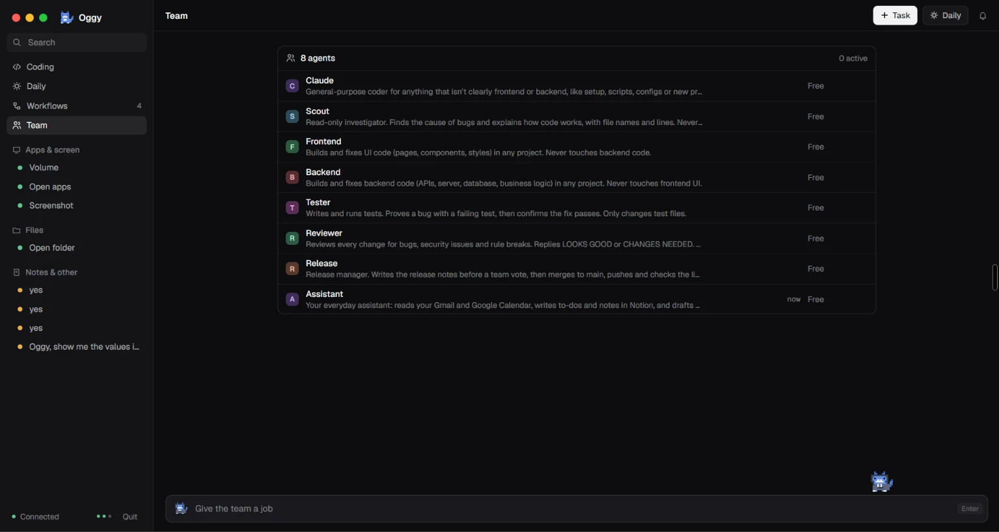

---

## Workflows

```text
make a new workflow named todo that checks my mail and creates a to-do list in Notion
run todo workflow
```

A workflow is a saved team play. You describe it once in plain words, and Claude designs it. Oggy then **checks every part against what's real** (your agents, teammates and projects) before saving it, so a workflow can't name an agent you don't have or a project that doesn't exist. A saved workflow runs exactly as it's drawn in the app, with nothing added at run time.

What a workflow step can do:

| Step | Example |
| --- | --- |
| **Give an agent a job** | "Tester agent: run the full test suite on paytrack" |
| **Run side by side** | Tester agent and Reviewer agent work at the same time |
| **Branch on an answer** | "If the Reviewer agent says changes are needed, stop here" |
| **Ask specific people** | "Ask Sara and Dev to approve. If anyone says no, roll back" |
| **Deploy or roll back** | The Release agent ships, or puts the last version back |
| **Report to a room** | Post the final summary in `#team` or a project room |

Run a workflow from the desktop, by voice, or from your phone (`@oggy run release day workflow`), or put it on a schedule.

**Release Day** has the Tester agent and Reviewer agent work at the same time, then deploys once you approve:

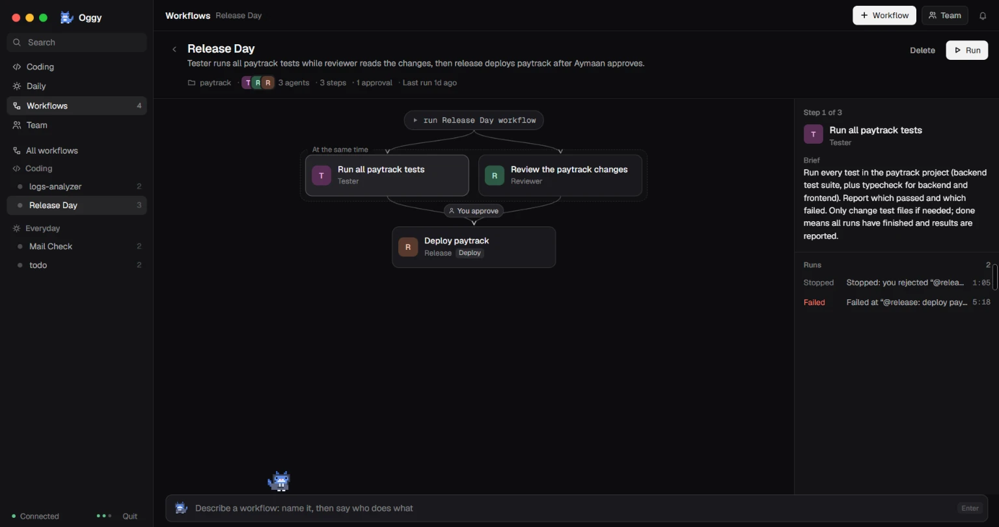

Workflows can run on a schedule while Oggy is open. A run missed while your PC was off happens when Oggy next opens, unless it's hours late.

<table>
<tr>
<td width="50%">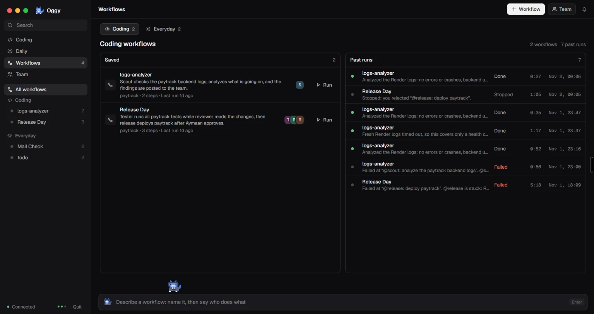<br /><sub>Coding workflows</sub></td>
<td width="50%">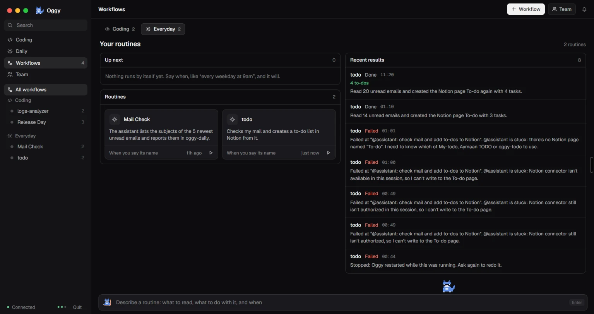<br /><sub>Everyday routines</sub></td>
</tr>
</table>

---

## How Switch makes this possible

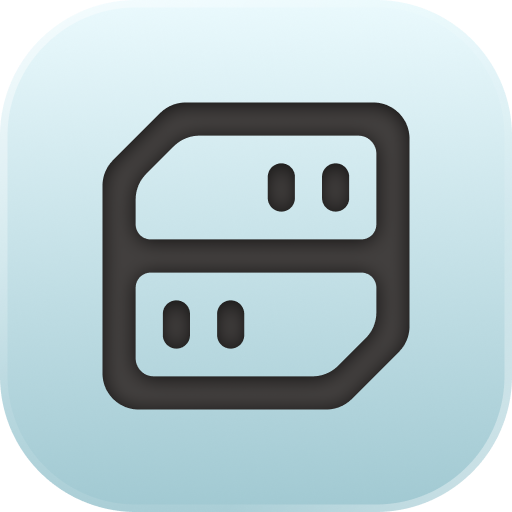

[Switch](https://switchagents.ai) puts people and AI agents together in shared **rooms** and bridges those rooms to Discord. Without it, Oggy would be a desktop app with no team, no phone control and no shared history. **Oggy is itself a Switch agent**, and appears in rooms as `@oggy`.

**Why building on Switch is the right design.** The usual way to build a multi-agent system is to write your own message bus, your own agent registry, your own approval UI, your own remote access and your own history store. Oggy builds none of these. Switch already treats agents and people the same way: both sit in rooms, post in threads and hold roles. So one design covers everything:

- **Agent hand-offs are just messages.** Oggy posts a step in a thread, the agent replies `DONE:`. Any Claude Code session can join the team with no custom integration.
- **Phone control comes for free.** Every room is a Discord channel, so the same thread that runs on your desktop is on your phone. You don't need open ports, a tunnel or a separate mobile app.
- **Team votes are just replies.** Teammates are already in the rooms, so a deploy vote is a `yes` in the thread, checked against each person's Switch id.
- **Nothing is hidden.** Every request, hand-off, question, approval and result is in one thread that people can read. You can audit what any agent did and why.
- **Agents keep context between jobs.** Room documents and GitHub references mean the next job starts with the project's history, not from scratch.
- **Adding agents scales the team.** Add a session in Switch Console, give it a seat, and Oggy starts handing it that kind of work.

| Switch feature | How Oggy uses it |
| --- | --- |
| **Agents** | The Scout agent, Backend agent, Tester agent and the rest are Claude Code agents in Switch. Oggy messages each one its step |
| **Rooms** | `#team` for coding, `#oggy-daily` for everyday tasks, and one room per project, created on demand |
| **Threads** | Every job is one thread: request, hand-offs, questions, approvals and result |
| **Discord bridge** | Every room is a Discord channel, which is how phone control works |
| **Roles** | Each agent's job is a seat in `#team`. Whoever holds the seat gets that kind of work |
| **Room documents** | Each room keeps a **Project log** of what every job changed and what you decided, so the next job starts informed |
| **References** | A project room gets its GitHub repo attached, so agents see history, issues and PRs |
| **Packages** | Team rules defined once are attached to every new project room |
| **People in rooms** | Teammates sit in the same rooms, so they can vote on releases |

**The contract with agents is one line.** Each agent ends its reply with a marker:

| Marker | Meaning |
| --- | --- |
| `DONE: ...` | Finished. The line becomes the step's result |
| `BLOCKED: ...` | Stuck. The run stops and tells you why |
| `LOOKS GOOD` / `CHANGES NEEDED` | The Reviewer agent's verdict. `CHANGES NEEDED` stops the run and tells you why |
| `ASK: ...` | The agent wants your OK before a heavy step. Oggy asks you and sends back your answer |

<p align="center"></p>

If an agent is silent for 3 minutes, Oggy pings it once. After 30 minutes with no `DONE` or `BLOCKED`, the step times out.

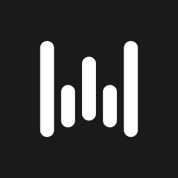

**And Wispr Flow gives Oggy its ears.** It types your speech into the Oggy box, so Oggy needs no speech model of its own. It's optional: without it you type. Project names are matched fuzzily against your real folders, so "dashboard crm" still finds `dashboard-crm`.

---

## Architecture

<p align="center">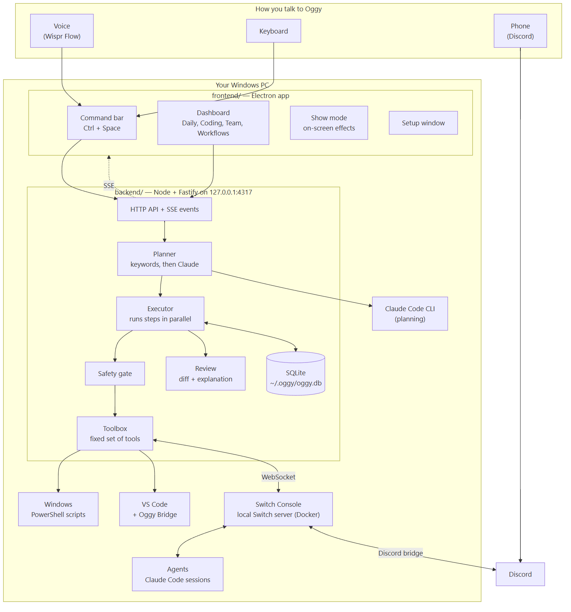</p>

| Part | Where | What it does |
| --- | --- | --- |
| **Electron app** | [frontend/](frontend/) | Command bar, dashboard, tray, setup window. The installed app also starts and stops the backend |
| **Backend** | [backend/](backend/) | Plans, checks and runs every step, talks to Switch, stores everything in SQLite. Listens only on `127.0.0.1:4317` |
| **Oggy Bridge** | [vscode-bridge/](vscode-bridge/) | VS Code extension: runs dev servers in a visible terminal and shows agent changes as a diff |
| **Website** | [landing/](landing/) | The landing page |

### A request, start to finish

<p align="center">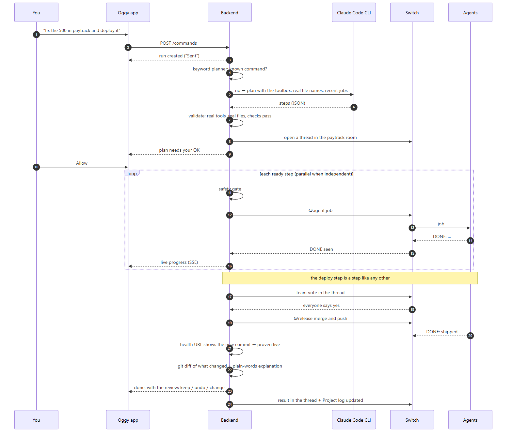</p>

### Planning

<p align="center">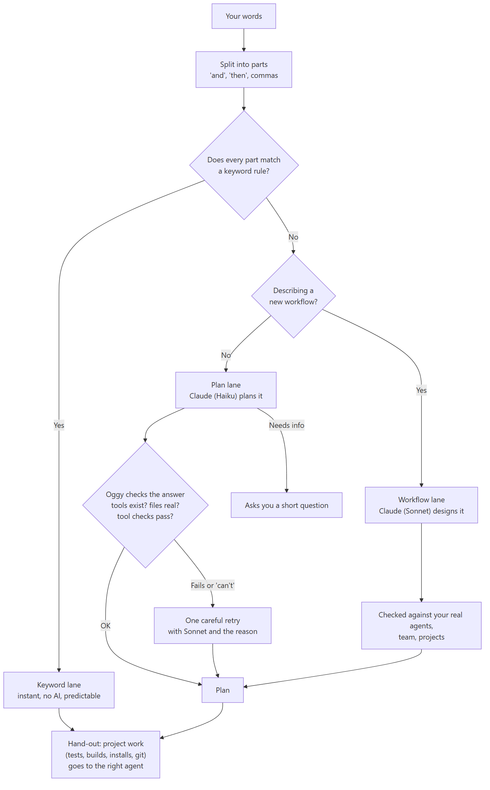</p>

- **Keyword lane.** Common commands are matched by rules: instant and always the same.
- **Plan lane.** Anything else goes to the Claude Code CLI (`claude -p`, Haiku). Oggy supplies the facts (real file names, project scripts, recent jobs) and checks the answer. A rejected plan gets one careful retry with Sonnet and the reason.
- **Hand-out.** Oggy never does project work itself: tests, builds, installs and `git status` go to the agent whose job it is.

### Running

A plan is a graph: each step lists the steps it waits for. The executor starts every step whose waits are done, so independent work runs in parallel. If a step fails, no new steps start, and the run reports who got stuck.

Each step is one **toolbox** tool, and each tool declares its own argument checks, risk level and approval preview:

| Group | Tools |
| --- | --- |
| Desktop | `app.open`, `app.close`, `folder.open`, `file.open`, `screen.shot`, `system.volume`, `keys.press` |
| Files | `file.copy`, `file.move`, `file.rename`, `file.zip`, `file.delete`, `undo` |
| Projects | `project.dev`, `project.stop`, `project.code`, `project.build`, `project.test`, `project.install`, `git.status` |
| Team | `agent.job`, `room.post`, `project.room`, `project.room.archive` |
| Shipping | `deploy`, `url.check` |
| Other | `calendar.event`, `workflow.create`, `workflow.save`, `memory.write`, `owner.lock`, `note` |

### Watching the agents

- **Live activity.** Agents are Claude Code sessions, which write each step to a transcript under `~/.claude/projects`. Oggy follows those transcripts for the Team view.
- **Code changes.** Oggy snapshots the project with git when a job starts and diffs every file the agents change. Undo uses git to put it back.

### Data and tech stack

Everything lives in `C:\Users\<you>\.oggy\`: `config.json` (settings and Oggy's Switch key, **never commit it**), `token` (owner token), `oggy.db` (SQLite: runs, approvals, workflows, memory) and `backend.log`.

| Layer | Tech |
| --- | --- |
| Desktop app | Electron 33, React 18, electron-vite, TypeScript |
| Backend | Node 22, Fastify 5, better-sqlite3, `ws`, TypeScript |
| Planning | Claude Code CLI (Haiku for quick plans, Sonnet for careful plans and workflows) |
| Agents and rooms | Switch (agent protocol over WebSocket, REST) |
| PC control | Fixed PowerShell scripts |
| Installer | electron-builder (NSIS), with Node and the backend bundled inside |
| Tests | Node's built-in test runner |

---

## Full setup: download the app

**For people who just want to use Oggy.** About 15 minutes, most of it on Discord and your agents.

### What you need

- Windows 10 or 11 (64-bit)
- [Docker Desktop](https://www.docker.com/products/docker-desktop/), for Switch Console's server
- [Claude Code](https://claude.com/claude-code), installed and signed in
- A Discord server where you can add a bot (for phone control)
- Optional: [Wispr Flow](https://wisprflow.ai) for voice, [VS Code](https://code.visualstudio.com) for projects and dev servers

### Step 1: Install Switch Console

1. Download [`switch-console-x64.exe`](https://github.com/sandbox-quantum/switch/releases/latest/download/switch-console-x64.exe) and run it.
2. Choose **Run a server on this computer** and wait for **Running locally**.

More detail: [Install Switch Console](https://docs.switchagents.ai/switch-rooms/getting-started/install-switch-console.md).

### Step 2: Add your agents

1. In Switch Console, open **Your Agents** and click the card with the plus sign.
2. Enter a **Name** (lowercase, no spaces) and a **Description**.
3. Leave **Run location** on **This computer**, set **Directory** to your code folder, and pick **Claude Code**.
4. Click **Add agent**.

Start with one agent, such as `claude-code`. Names like `scout`, `backend` or `tester` let Oggy guess each agent's job. More detail: [Onboard your agents](https://docs.switchagents.ai/switch-rooms/getting-started/onboard-your-agents.md).

### Step 3: Connect Discord

1. In the [Discord Developer Portal](https://discord.com/developers/applications), create an application, open **Bot** and copy the token.
2. Turn on **Server Members Intent** and **Message Content Intent**.
3. Under **OAuth2 > URL Generator**, pick the `bot` and `applications.commands` scopes and the permissions the Switch guide lists, then invite the bot.
4. In Switch Console, go to your server's **Home** → **Messaging apps > Connect > Discord**, and enter the bot token and server ID.
5. Link your Discord account when asked (**This is me**).

More detail: [Connect Discord](https://docs.switchagents.ai/switch-rooms/deploy/messaging-apps/discord.md).

### Step 4: Make Oggy's two rooms

Create Discord channels named exactly `team` (coding jobs) and `oggy-daily` (everyday tasks), and post any message in each. Switch turns them into rooms.

### Step 5: Install Oggy

Run [**Oggy-Setup.exe**](https://github.com/AymaanPathan/oggy/releases/latest/download/Oggy-Setup.exe). The setup window has three parts:

- **Connect.** Oggy finds Switch Console and registers itself. You don't copy any keys.
- **Your team.** Tick the agents Oggy may use and pick each one's job.
- **About you.** Your name, your Discord username (the only one Oggy obeys) and your code folder.

If Windows shows "Windows protected your PC", click **More info → Run anyway**.

### Step 6: Invite Oggy to the rooms

In Switch Console, invite Oggy to `team` and `oggy-daily`. Its name is the one shown in the setup window, `oggy.<your-windows-username>` by default. Then quit Oggy from the tray and open it again, so it picks up the rooms.

### Step 7: Try it

1. Check that the dashboard says **Connected**.
2. Press `Ctrl` + `Space` and run `take a screenshot`.
3. In Discord, send `@oggy open my Downloads` to `#oggy-daily`.
4. Type `lock oggy to me` in the Oggy box, so only your exact Discord account can give orders.

### Optional extras

- **Voice:** install [Wispr Flow](https://wisprflow.ai). Nothing else to set up.
- **VS Code:** install [vscode-bridge/oggy-bridge.vsix](vscode-bridge/oggy-bridge.vsix) via Extensions → **...** → **Install from VSIX...**.
- **Mail, calendar and Notion:** add an agent called `assistant` and connect Gmail, Google Calendar and Notion to the Claude account it runs on.
- **Team votes and deploys:** merge your teammates and health URLs into `C:\Users\<you>\.oggy\config.json`, then restart Oggy:

  ```json
  {
    "team": [{ "name": "Rahul", "discordUsername": "rahul-discord-name" }],
    "deploy": { "paytrack": { "url": "https://your-app.example.com/health" } }
  }
  ```

- **Change your setup:** right-click the tray icon → **Set up Oggy again…**.
- **Switch on another machine:** in setup, choose **Use a different Switch server** and use a registration key from its admin page.

---

## Setup from source

**For people who want to change Oggy's code.** Do Steps 1 to 4 and Step 6 above too.

You'll also need [Node 22](https://nodejs.org), [pnpm](https://pnpm.io/installation) and [Git](https://git-scm.com), with `claude` on your `PATH`.

```powershell
git clone https://github.com/AymaanPathan/oggy.git
cd oggy
cd backend; pnpm install; cd ..
cd frontend; pnpm install; cd ..
```

**First time only, run the setup window** (keep this terminal open):

```powershell
cd frontend
$env:OGGY_SETUP = "1"; pnpm dev
```

**Then start the backend in a second terminal:**

```powershell
cd backend
pnpm dev
```

You should see `[oggy] backend on http://127.0.0.1:4317`, and the dashboard should say **Connected**. After that, just run `pnpm dev` in both `backend/` and `frontend/`.

> **Tip:** set `$env:OGGY_DATA_DIR = "C:\temp\oggy-test"` in both terminals to test without touching your real settings.

### Repo layout

```text
oggy/
├── backend/src/
│   ├── index.ts              HTTP routes, SSE stream, startup
│   ├── planner.ts            Keyword lane, plan lane, workflow lane, hand-out
│   ├── executor.ts           Runs steps as a graph, approvals, results
│   ├── gate.ts               The three-question safety gate
│   ├── toolbox.ts            Every tool, with its checks and risk
│   ├── desktop.ts            Windows actions (fixed PowerShell scripts)
│   ├── review.ts             Explains changes: keep / undo / change
│   ├── codeWatch.ts          Git snapshots and diffs of agent work
│   ├── agentLive.ts          Live agent activity from Claude Code transcripts
│   ├── rooms.ts              "@oggy" from Discord, yes/no replies
│   ├── workflow.ts, schedule.ts, team.ts, ship.ts, vscode.ts, db.ts, ...
│   └── integrations/         switch.ts, claudeCode.ts, codex.ts, telegram.ts
├── frontend/
│   ├── src/main/             Windows, tray, shortcut, setup, bundled backend
│   ├── src/renderer/src/     React UI: CommandBar, OggyApp, Pet, Show, Setup, Workflows
│   └── scripts/              pack.mjs (bundle for installer), release.mjs
├── vscode-bridge/            VS Code extension (and a prebuilt .vsix)
├── landing/                  The website
└── switch/config.example.json
```

### Useful commands

| Run in | Command | What it does |
| --- | --- | --- |
| `backend/` | `pnpm dev` / `pnpm test` / `pnpm typecheck` | Run with auto-reload / tests / type check |
| `frontend/` | `pnpm dev` / `pnpm typecheck` | Run the app with hot reload / type check |
| `frontend/` | `pnpm dist` | Build `build/installer/Oggy-Setup.exe`, with Node and the backend bundled inside |
| `frontend/` | `pnpm release` | Build and publish a GitHub release (needs `gh auth login` and a new `version` in `frontend/package.json`) |

### Adding a new tool

1. Add it to `TOOLBOX` in [backend/src/toolbox.ts](backend/src/toolbox.ts) with `title`, `args`, `check`, `risky`, `preview` and `run`.
2. If it touches Windows, add a fixed PowerShell script in [backend/src/desktop.ts](backend/src/desktop.ts) that reads values from `OGGY_*` environment variables.
3. Optionally add a keyword rule in [backend/src/planner.ts](backend/src/planner.ts).
4. Add a test and run `pnpm test`.

The plan lane picks up new tools automatically.

---

## Configuration

The setup window writes `~/.oggy/config.json` for you. The full template is [switch/config.example.json](switch/config.example.json).

| Key | What it's for |
| --- | --- |
| `switch.apiUrl`, `switch.agentId`, `switch.agentApiKey` | Oggy's Switch login. **Secret** |
| `switch.agentName` | Oggy's name in rooms |
| `switch.packages` | Switch packages attached to every new project room |
| `owner.name`, `owner.discordUsername` | Who you are, and the only Discord user Oggy obeys |
| `owner.switchUserId` | Your exact account. Set by `lock oggy to me` |
| `rooms.team`, `rooms.oggyDaily` | Room ids. Leave empty to find them by name |
| `team` | Teammates who vote on releases |
| `deploy.<project>` | `url` (health check), `branch` (default `main`), `service` or `hooks` (Render) |
| `agents.<alias>` | `name` in Switch, `does` (what Claude picks it by), `default` |
| `paths.codeFolder`, `paths.screenshots` | Your projects folder, and where screenshots go |
| `safety.needsApproval` | Extra tools that always ask first |
| `safety.allowedFolders`, `safety.allowedApps` | Where file tools may work, and extra apps Oggy may open or close |
| `safety.onlyObeyOwner` | Only run Discord commands from you (default `true`) |

Environment variables override the file. Set them in your shell (no `.env` file is read): `OGGY_PORT`, `OGGY_DATA_DIR`, `OGGY_PROJECTS_DIR`, `OGGY_SHORTCUT` (default `Control+Space`), `OGGY_SETUP`, `SWITCH_API_URL`, `SWITCH_AGENT_ID`, `SWITCH_API_KEY`, `RENDER_API_KEY`, `CLAUDE_BIN`. See [backend/.env.example](backend/.env.example).

---

## Local API

The backend listens on `http://127.0.0.1:4317` only. Every route except `/health` needs the token from `~/.oggy/token`:

```powershell
$token = Get-Content "$HOME\.oggy\token"
Invoke-RestMethod http://127.0.0.1:4317/commands -Method Post `
  -Headers @{ Authorization = "Bearer $token" } `
  -ContentType 'application/json' -Body '{"text":"take a screenshot"}'
```

| Route | What it does |
| --- | --- |
| `POST /commands` | Run a command |
| `GET /runs`, `GET /runs/:id`, `GET /runs/:id/detail` | Jobs, their steps, changes and trace |
| `GET` / `POST /runs/:id/review` | Read or answer a review |
| `GET /approvals?pending=1`, `POST /approvals/:id` | What's waiting, and answer it |
| `GET /team`, `GET /toolbox`, `GET /workflows`, `GET /memory` | Live agents, tools, workflows, memory |
| `GET /events` | Server-sent events: run updates, approvals, logs |
| `GET /health` | Is the backend up (no token) |

---

## Security model

- **Local only.** The backend binds to `127.0.0.1`.
- **Owner token** on every API call, compared in constant time.
- **Owner-only from Discord**, checked again before every step.
- **No arbitrary commands.** Only toolbox tools. Desktop actions are fixed PowerShell scripts that read values from environment variables, so a file name can't inject code. Oggy Bridge only runs `<package manager> run <script>`.
- **Allowed folders, apps and file types** only.
- **Risky means ask; irreversible means vote.** Approvals are re-checked after your yes.
- **Proof, not claims.** Changes come from git, deploys are checked against the live site.
- **Secrets stay put.** Setup keeps keys in Electron's main process. Render logs go to a file, never into rooms.

> **Never commit `~/.oggy/config.json` or your token.** If you do, re-run setup from the tray to get a new Switch key.

---

## Troubleshooting

| What you see | What to do |
| --- | --- |
| "Switch Console isn't installed on this PC" | Do [Step 1](#step-1-install-switch-console) |
| "Switch Console's server isn't running" | Open Switch Console and wait for **Running locally** |
| "Switch is taking too long to answer" | Switch has just started. Wait a moment and click **Connect** again |
| No room named "team" | Do [Step 4](#step-4-make-oggys-two-rooms) and [Step 6](#step-6-invite-oggy-to-the-rooms) |
| Dashboard says **Disconnected** | The backend isn't running. Check `~/.oggy/backend.log`, or run `pnpm dev` in `backend/` |
| Oggy ignores your Discord messages | Check your Discord username in setup and that Oggy is in the room. Your PC must be on |
| An agent never answers | Check in Switch Console that it's running and Claude Code is signed in |
| "Can't do that yet" for a normal request | Check `claude -p "hi"` works in a terminal |
| `Ctrl` + `Space` does nothing | Another app has it. Set `OGGY_SHORTCUT`, e.g. `Control+Shift+Space` |
| A dev server won't start | Install Oggy Bridge and open the project in VS Code |
| Deploy says "answering" instead of "proved" | Make your health URL include the git commit hash |
| `better-sqlite3` errors | Use Node 22 and run `pnpm rebuild better-sqlite3` in `backend/` |

---

## FAQ

**Does Oggy work on macOS or Linux?** Not yet. Desktop actions use PowerShell and Windows APIs.

**Does my code leave my PC?** Oggy runs locally. Planning uses the Claude Code CLI, which sends your request and relevant file names to Claude. Agents are Claude Code sessions. Room messages go through your Switch server and Discord.

**Do I need all 7 agents?** No. One general Claude agent is enough to start.

**Do I need Discord?** Only for phone control and team votes.

**What if I close Oggy mid-job?** The job can't continue without the backend. Next time Oggy starts, it marks the job as interrupted.

---

## Status

🚧 **Active development.** Built for the Flip the Switch Hackathon.

**Working today:**

- Windows desktop control by voice and keyboard
- Phone control through Discord
- Multi-agent coding with parallel steps
- Plan approval, code review with undo, and team votes
- Workflows, including scheduled ones
- Deploys with live verification (Render)

**Planned:**

- Telegram control (the integration is stubbed in [backend/src/integrations/telegram.ts](backend/src/integrations/telegram.ts))

---

## Limitations

- **Windows only.**
- **Your PC must be on**, with Switch Console and Oggy running, for phone control and agent jobs.
- **Scheduled workflows run only while Oggy is open.**
- **Claude Code is required** for planning and for the agents.
- **Phone control and team votes depend on Switch and Discord.**
- **Risky actions always need your approval**, so Oggy can't do everything unattended.
- **Live deploy verification** expects a health URL that shows the deployed commit.

---

## Contributing

1. Fork the repo and create a branch.
2. Make your change, and add a test next to the module you touched.
3. Run `pnpm test` and `pnpm typecheck` in `backend/`, and `pnpm typecheck` in `frontend/`.
4. Open a pull request explaining what changed and why.


<div align="center">

### Built for the Flip the Switch Hackathon

Oggy was built for the [**Flip the Switch Hackathon**](https://www.wemakedevs.org/hackathons/switch), hosted by WeMakeDevs and DevTools Academy with Switch.

### ⭐ Like Oggy? [Star the repo](https://github.com/AymaanPathan/oggy)

</div>
